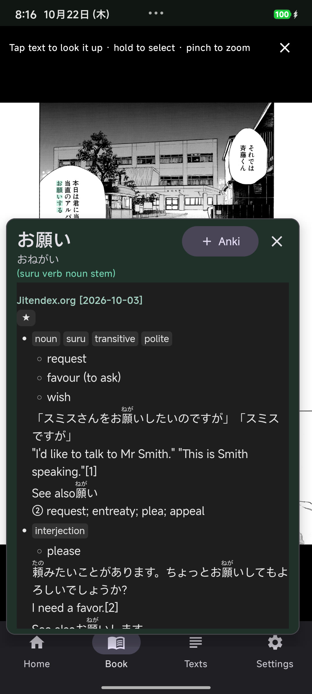
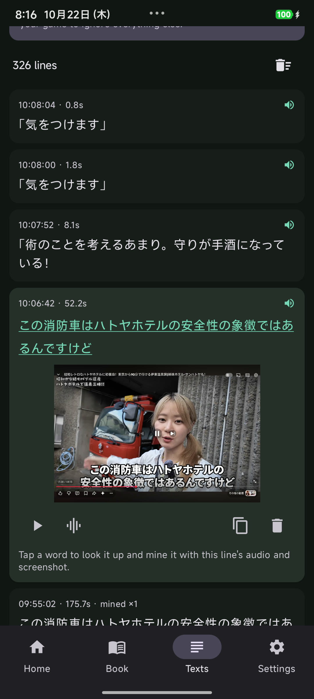
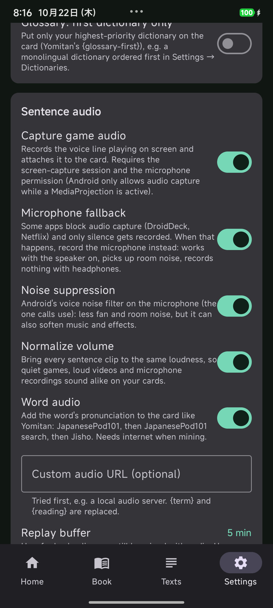
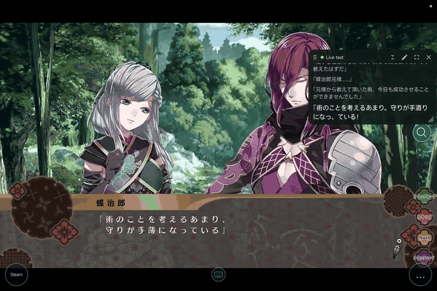
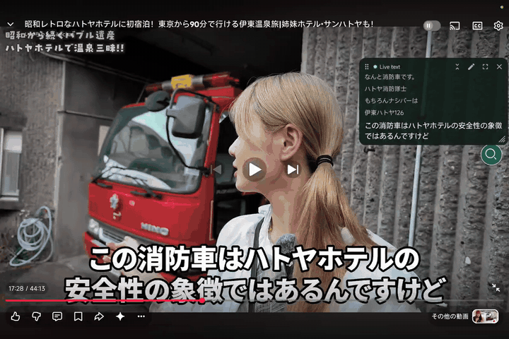

# Droid Sentence Miner

A native Android sentence miner for Japanese immersion: OCR text from any app with a floating
popup, look words up with Yomitan dictionaries, and mine them into Anki — plus the game's voice
line as sentence audio.

Inspired by [GameSentenceMiner](https://github.com/bpwhelan/GameSentenceMiner), rebuilt for Android
with [Yomitan](https://github.com/yomidevs/yomitan) dictionary compatibility.

**Website:** [wilsonnet.github.io/droid-sentence-miner](https://wilsonnet.github.io/droid-sentence-miner/) ·
**Docs:** [Installation](https://wilsonnet.github.io/droid-sentence-miner/docs/getting-started/installation/) ·
[Auto OCR](https://wilsonnet.github.io/droid-sentence-miner/docs/guides/auto-ocr/) ·
[Troubleshooting](https://wilsonnet.github.io/droid-sentence-miner/docs/reference/troubleshooting/)

<p align="center">
  
  
  
</p>

## Demo

| Visual novel (Nightshade on Steam via DroidDeck) | YouTube hardsubs |
| --- | --- |
| [](docs/videos/nightshade-mining.mp4) | [](docs/videos/youtube-mining.mp4) |
| Tap 手薄 in the game's text box → definition → *Anki* → ✓ *In Anki* | Tap 消防車 in the burned-in subtitle → *Anki* → ✓ *In Anki* |

Both cards got the sentence, a screenshot, word audio and the sentence's voice clip (click a
GIF for the MP4; recorded on a Xiaomi Pad 7).

## Features

- **Auto OCR mode** — draw boxes over the game's text areas once (dialogue box, name box,
  subtitles; kept separately for portrait and landscape) and keep playing. The areas are read
  every ~400 ms; each new line is logged with the moment it appeared, the moment it went away and
  a screenshot. Repeated reads must agree before a line counts, and the stored text is the
  consensus of all reads of that line, so fades, typewriter text and OCR noise over moving video
  don't create junk; background signage is filtered out. Visual novel text that types itself out
  a few characters at a time is followed to the end of the line (each frame is compared with the
  last one OCR'd, cell by cell), so lines aren't cut mid-sentence.
- **Screen dictionary (tap the real text, in any app)** — while auto OCR runs, each read is laid
  as an invisible text layer exactly over the subtitles/dialogue on screen (meikiocr's and ML Kit's
  per-character positions). Tap a character in a YouTube hardsub or a game's text box and the word
  covering it lights up with its definition right next to it; hold and drag to select characters.
  The layer is one invisible window per line, fitted to it, so touches elsewhere (a game's
  buttons, the empty part of a text box) still reach the app. Videos are fast, so a
  lookup pauses playback (media key: YouTube and most players) and resumes it when the popup closes;
  if you pause yourself, the layer stays and you can tap word after word. Mining links the
  log line, so the card gets the sentence, screenshot and voice clip.
- **Already in Anki** — like Yomitan, the popup checks your note type for the word: if it already
  has a note the button shows ✓ *In Anki* instead of making a duplicate. A card keeps being added
  if you close the popup right after tapping *Anki*.
- **Tablets and landscape** — tabs move to a side rail and screens sit in a centered column.
- **Live text window** — a floating feed of the lines over the game, updated in real time. Tap
  a word in it and the definition pops up right next to it (same popup as the on-screen text
  layer; mining uses that line's audio and screenshot); hold a line to open it in the full panel. Scroll back through the history (new
  lines only pull it down while you're at the bottom; *Latest* jumps back), drag the corner grip
  to resize, shrink it to a one-line ticker (⌃⌄), or open it fullscreen with big text to read
  back (auto OCR pauses there, since it would cover the game). Size and position are remembered
  per orientation (a big portrait window would cover a landscape video), and so is the mode;
  fullscreen always reopens as the normal window.
- **App focus** — share "A single app" (Android 14+) and pick the game: only it is read, and
  auto OCR pauses while you are in other apps or in Droid Sentence Miner itself.
- **Book mode (paper books, manga)** — the *Book* tab takes a photo with Samsung Camera on Galaxy
  phones (any camera app elsewhere) or picks one from the gallery, reads the page with ML Kit — vertical (tategaki, columns right to left)
  and horizontal print — and outlines each paragraph on the photo. Tap a paragraph, tap a word,
  and mine it: the card gets the word's sentence (cut at 。！？, keeping closing quotes) and the
  paragraph cropped from the photo as its picture. Hold and drag over the text to force your own
  selection (hold alone = one character, e.g. a single kanji). The definition pops up right at the
  word (below it, or above when there is no room), instantly and without a scrim, so tapping the
  next word just moves it. Tap Japanese inside a definition to look that up too (← goes back). Ruby lines, page numbers and sentences split
  across blocks are handled; ✎ fixes a misread before mining.
- **Overlay dictionary mode (read on the photo)** — Mokuro-style: after a photo the page opens
  full screen with the OCR text laid invisibly over the printed characters (ML Kit's per-character
  boxes). Tap any character on the photo, in a speech bubble or a column of print, and the word
  starting there lights up with its definition popping up beside it; hold and drag to select
  characters yourself; pinch to zoom, drag to pan.
- **One add button per reading, like Yomitan** — when a lookup finds several headwords (呼び and
  呼ぶ, 取り and 取る, different readings of one kanji), the popup lists each with its own
  *+ Anki* button and in-Anki state; the card gets only that headword's reading, glossary,
  pitch and frequency. The header button adds the first one.
- **Mining feedback** — the popup's Anki button spins while the card is built, turns green
  (*Added*) when it's in, and a toast confirms it (or says why not) even if the popup was closed.
- **Texts page** (GSM's texthooker) — every recognized line, newest first. Tap a line, tap a word,
  and mine it: the card gets that line's sentence, its screenshot and its voice clip.
- **Replay buffer sentence audio** — the last 5 minutes (configurable 1–10) of game audio are kept
  in memory. Any line still inside the buffer can be mined with audio cut from when it appeared to
  when it was replaced (± configurable offsets). Preview or fine-tune it in the waveform editor
  before mining; optional (experimental) silence trimming is in Settings.
- **Floating popup overlay** — a draggable bubble that stays on screen. Tap it, drag a box over a
  word and its definition pops up right next to it (*Quick lookup*, the default); other words in
  the box can be tapped too. Long-press opens the menu, where *Bubble tap* switches to *Scan
  region* (the region editor with Scan / Full screen / Live and the results panel). The
  notification stays available as a shortcut.
- **Japanese OCR trained on games** — on-device [meikiocr](https://github.com/rtr46/meikiocr)
  (ONNX Runtime), a detector + recognizer trained on Japanese video-game text: 3–19× fewer
  character errors than ML Kit on stylized, outlined game/subtitle fonts (small kana, dakuten).
  One-time 31 MB model download; ML Kit (with a GameSentenceMiner-style two-pass pipeline) is
  built in as the fallback/alternative engine.
- **Yomitan dictionaries & drag-and-drop priority** — import any Yomitan/Yomichan format 3 `.zip`
  (Jitendex, JMdict, JMnedict, KANJIDIC, frequency dictionaries) or install recommended dictionaries
  (Jitendex, JMdict, KANJIDIC, Kanjium pitch accents, JMnedict names) with one tap. Dictionaries can
  be reordered via drag-and-drop with priority badges (`#1`, `#2`…) just like in Yomitan to control
  definition ranking and `{glossary-first}` mining. Proper-name dictionaries (JMnedict) automatically
  start at the bottom of the list so they never shadow standard vocabulary.
  Term, kanji, tag, term-meta and kanji-meta banks are all parsed, including structured-content
  glossaries and dictionary images. Updatable dictionaries (Jitendex, JMnedict, or any Yomitan dictionary
  with an `indexUrl` in `index.json`) are checked for newer revisions automatically and can be
  updated in place with one tap, preserving custom priority order and enabled state.
- **Deinflection & word scanning** — a full Japanese deconjugator drives longest-match scanning of
  scanned text and tap-to-look-up, with the same rules Yomitan uses.
- **Anki mining** — two backends:
  - **AnkiDroid API** (no network needed; cards, images and audio via the official API), and
  - **AnkiConnect** (desktop Anki with the AnkiConnect add-on; card + media upload over HTTP).
  Cards include Expression, Reading, Meaning (rendered glossary), Sentence, Image (captured
  screenshot, scaled to a max height — 462 px by default, aspect ratio kept, 0 = original — set in
  Settings → Anki), Audio (sentence voice line), **Word audio** and Source. Existing note types are
  filled by field name the way Yomitan/GSM fill them — e.g. Anime Cards: Word, Reading, Glossary,
  Context Sentence (Sentence stays empty so it stays a word card), Word Audio, Audio, Picture.
  **Settings → Anki → Fields** shows what goes into each field of the chosen note type and lets you
  pick the content per field (Word, Reading, Glossary, Sentence, Screenshot, Sentence/Word audio,
  Pitch graph, Source or nothing); the mapping is saved per note type, *Reset to automatic* drops it.
- **Word audio like Yomitan** — the word's pronunciation is fetched from the same sources Yomitan
  uses for Japanese, in the same order: JapanesePod101 (placeholder clip rejected by hash),
  JapanesePod101 dictionary search, Jisho; plus an optional custom URL (`{term}`/`{reading}`,
  e.g. a local audio server) tried first. Option to put only the first dictionary on the card
  (Yomitan's `{glossary-first}`).
- **Pitch accent graph** — the same SVG Yomitan's `{pitch-accent-graphs}` writes (byte-identical to
  the user's existing Yomitan cards), filled into a pitch/graph field such as Anime Cards' *Graph*.
  Uses any installed Yomitan pitch dictionary, or the free Kanjium pitch accents (124k words,
  one-click install from *Settings → Dictionaries* or the Home setup card).
- **Sentence audio** (Android 10+) — captures playback audio through the existing MediaProjection
  session (the Android equivalent of GSM's loopback capture) into the replay buffer, with a
  waveform **audio editor** to trim the exact line before mining. Every clip is **normalized** to
  the same loudness (on by default, *Settings → Sentence audio*).
- **Microphone fallback** — some apps block audio capture and Android hands over pure silence
  (DroidDeck, which runs Steam games, targets Android 9; Netflix). Turn on *Microphone fallback*
  (Settings or the bubble menu; off until you allow it) and DSM records the microphone whenever
  device audio is silent while something is playing, and switches back as soon as device audio
  returns. The mic goes through an FX chain built for a speaker heard through a microphone (each
  stage on by default, can be turned off): Android's voice **noise suppression**, a **speaker
  correction EQ** — a 120 Hz rumble filter plus a 19-band curve measured on your device by
  *Calibrate* (6 s of pink noise played and recorded back), which restores the missing low mids
  and tames the harsh 4–8 kHz resonance of tablet/phone speakers — then a **compressor** that
  squeezes loud peaks so normalization can lift thin, quiet dialogue. Works with the speaker on;
  picks up room noise; records nothing with headphones.
- **Mining history** — recent cards with a status showing whether they made it into Anki.
- **Text selection lookup** — other apps can send selected text via `ACTION_PROCESS_TEXT`, including
  Samsung's text selection on screenshots/images and Circle to Search. A selected word is matched to
  the newest logged line containing it, so the card still gets the full sentence, screenshot and
  audio; a selected sentence is logged as a new line. Handy for text auto OCR can't read (vertical
  or handwritten-style), using Google's cloud OCR by hand.

## Requirements

- Android 8.0 (API 26) or newer. Audio capture requires Android 10+; screen sharing follows the
  Android 14/15 consent flow (app picker + foreground service type).
- [AnkiDroid](https://github.com/ankidroid/Anki-Android) (2.16+) and/or desktop Anki with
  [AnkiConnect](https://foosoft.net/projects/anki-connect/).

## Download

Signed APKs are attached to each [GitHub release](https://github.com/WilsonNet/droid-sentence-miner/releases)
(`droid-sentence-miner-vX.Y.Z.apk`). Download it on the device and allow installs from your browser
or file manager; newer releases upgrade in place.

## Website and docs

The marketing site and these docs live in [`site/`](site/) — Astro 7, Starlight for the docs and
Tailwind CSS v4 for the landing page. It is a separate Node project; the Android build ignores it.
Strict TypeScript and Biome run in CI, and `.github/workflows/site.yml` deploys `site/dist` to
GitHub Pages on every push that touches the folder.

```bash
cd site
pnpm install
pnpm dev      # http://localhost:4321/droid-sentence-miner/
pnpm check    # astro check + biome check --error-on-warnings
pnpm build    # site/dist
```

## Building from the command line

No Android Studio required.

```bash
# 1. Toolchain — JDK 21 + Android CLI (Linux example, no root needed)
curl -fsSL https://dl.google.com/android/cli/latest/linux_x86_64/install.sh | bash
mkdir -p ~/Android/tools && curl -sSL "https://api.adoptium.net/v3/binary/latest/21/ga/linux/x64/jdk/hotspot/normal/eclipse" | tar xz -C ~/Android/tools
export JAVA_HOME=$(echo ~/Android/tools/jdk-21*)      # macOS: brew install openjdk@21
export ANDROID_HOME=$HOME/Android/Sdk
export PATH="$JAVA_HOME/bin:$ANDROID_HOME/platform-tools:$PATH"

# 2. Android SDK packages
android sdk install platform-tools platforms/android-36 build-tools/35.0.0 emulator \
                    system-images/android-35/google_apis_playstore/x86_64
echo "sdk.dir=$ANDROID_HOME" > local.properties

# 3. Build & test
./gradlew testDebugUnitTest          # 161 JVM unit tests
./gradlew connectedDebugAndroidTest  # 4 on-device tests (VAD + AAC encoding)
./gradlew assembleDebug              # app/build/outputs/apk/debug/app-debug.apk

# 4. Install
adb install -r app/build/outputs/apk/debug/app-debug.apk
```

## Usage

1. **Dictionaries** — open *Settings → Dictionaries* and install **Jitendex** and **Kanjium pitch accents**
   with one tap each (or import any Yomitan `.zip`, e.g. a monolingual dictionary; drag it first
   if you want only it on cards). In *Settings → OCR*, tap *Download meikiocr models* (31 MB).
2. **Anki** — in *Settings → Anki* pick a backend:
   - *AnkiDroid*: install AnkiDroid, grant the API permission from that page, and enable
     *Settings → Advanced → AnkiDroid API* inside AnkiDroid.
   - *AnkiConnect*: start Anki with the AnkiConnect add-on and enter the URL
     (e.g. `http://192.168.1.10:8765`).
   Pick a deck and note type (a "Droid Sentence Miner" note type is created automatically).
3. **Quick lookup** — tap the bubble, drag a box over a word, lift: the definition pops up next
   to it with *+ Anki* (sentence = the boxed text, audio from the replay buffer). Tap another word
   in the box to look that one up; tap anywhere else to close. A tap without a drag cancels.
   Turn on *Accessibility → Installed apps → Quick lookup screenshots* once (Android 11+; the
   first bubble tap opens that page) and quick lookups and one-off scans never ask for screen
   sharing again — the service only takes a screenshot when you box a word and reads no app
   content. If the switch is greyed out (APK installed from a browser/file manager, Android 13+):
   *App info → ⋮ → Allow restricted settings*. Auto OCR still asks for screen sharing each
   session: Android has no other way to record the playback audio for sentence cards.
4. **Auto OCR (recommended for games/video)** — open the game, long-press the bubble → *Start
   auto OCR* (or set *Bubble tap* to *Scan region* and tap the bubble → *Live*); *Live* uses the box you drew as the text area when this orientation has none, and
   turns into *Stop live* while auto OCR runs. In the
   share dialog choose *A single app* → your game. If no text area exists for the current
   orientation the area editor opens: drag boxes over the dialogue/subtitle area (drag to move,
   corners to resize, × to delete; drag the toolbar by ⠿ out of the way) and *Save*. To change
   them later (e.g. a different video), tap ✎ in the *Live text* window or long-press the bubble →
   *Auto OCR text areas*. If the screen capture ends (the captured app was closed, consent
   revoked), the bubble menu offers *Restart screen capture*. New lines
   appear in the floating *Live text* window — tap a word to look it up in place and mine it with
   the line's audio and screenshot (hold a line for the full panel). Everything is also on the *Texts* tab.
   While it runs, just tap a word in the real subtitle on screen to look it up (the video pauses
   until you close the definition). Toggles: *Settings → Tap text on screen to look it up* and
   *Pause the video while looking up*.
5. **Manual scan (one-off)** — long-press the bubble → *Scan once: pick a region* (or tap it in
   *Scan region* mode), adjust
   the capture box and hit *Scan region*. This box is separate from the auto OCR text areas. Tap a
   highlighted word for definitions, then *Anki*. Manual scans are logged on *Texts* too.
6. **Audio** — on by default; grant the microphone permission when asked (Android requires it for
   playback capture). *Settings* has the buffer length, start/end offsets, silence trimming and
   volume normalization. Apps that opt out of capture (DroidDeck, Netflix) record silence unless
   you enable *Microphone fallback* (Settings or the bubble menu).
6. **Books** — open the *Book* tab, *Take photo* of the page (flat, well lit, filling the frame),
   tap the paragraph on the photo, then tap a word in its text to look it up and *Anki* it
   (hold + drag to pick the exact characters yourself; tap words inside the definition to dig deeper).
   After a photo the page opens in the overlay reader: tap the printed text itself to look it up,
   pinch to zoom; ✕ or Back returns to the paragraph view (*Read on the photo* reopens it).
   Arrows step through paragraphs; ✎ corrects the OCR text.
7. **Test drive** — the Home tab has a built-in sample (a public-domain Aozora Bunko passage) and
   an image picker to test OCR + lookup without a game.

## How it works

```
MediaProjection ──► ScreenCaptureManager ──► AutoOcrController ──► TextLineTracker ──► TextLog (Room)
                        │   (new frames only)    (fast OCR → stable?     (start/end times,    │
                        │                         → two-pass re-read)      screenshot)       │
                        │                                                                    ▼
                        └──► AudioCaptureManager ──► AudioRingBuffer ──► ClipWindow + VoiceTrimmer
                                (AudioPlaybackCapture)   (last N min)         (line's voice clip)
                                                                                    │
                                                                                    ▼
   OCR text ──► TermLookup.scan() ──► JapaneseDeinflector ──► Room DB (Yomitan dictionaries)
                        │                                        │
                        ▼                                        ▼
                 Overlay popup (Compose + WebView)        Glossary parser/Renderer
                        │
                        ▼
                 CardMiner ──► AnkiDroid API or AnkiConnect
```

- **OCR**: meikiocr by default — a D-FINE text-line detector (960×544) finds lines, and a
  recognizer that treats recognition as *character detection* reads each 960×32 line; characters
  are de-duplicated by overlap and read left to right (`MeikiOcr`, `MeikiDecoder`). Wide, short
  crops (a subtitle band) run a shorter cut of the same detector (960×160…448) and short lines a
  narrower recognizer input, so the zero padding isn't computed: 2–2.7× faster, same accuracy.
  The cuts are tiny graphs shipped in the APK that read their weights from the downloaded models
  (`tools/meiki-variants`). With ML Kit
  instead: pass 1 recognizes the region, pass 2 re-reads each line upscaled and keeps the better
  reading. Either way rows are merged, furigana and off-size background text are dropped, and auto
  OCR stores the consensus of all reads of a line.
- **Book photos** (`book/`): always ML Kit (meikiocr only reads horizontal game text). ML Kit's
  blocks are kept as paragraphs; `PageLayout` decides vertical vs horizontal from line shapes,
  orders columns right→left (lines top→bottom when horizontal), drops thin kana-only ruby lines
  and non-Japanese blocks, and joins a block that ends mid-sentence with the adjacent one.
- **Matching**: `JapaneseDeinflector` expands every substring of the OCR text into dictionary-form
  candidates (Yomitan/Jiten rules), a single batched SQL query resolves them, and longest-match-wins
  builds the clickable word list. Grammar-only single-kana matches are filtered as noise.
- **Storage**: Room DB with `terms`, `kanji`, `tags`, `term_meta`, `kanji_meta`, `dictionaries` and
  `mined_cards` tables; indices on expression/reading for fast lookup.
- **Overlay**: a foreground service draws the bubble, capture selector and a Compose result panel;
  MediaProjection consent is handled by a transparent activity that forwards the result to the
  service (with the Android 14/15 foreground-service-type ordering).

## Dictionary compatibility

Yomitan/Yomichan format 3 (and legacy format 2) zips are supported:

| Bank | Usage |
| --- | --- |
| `index.json` | title, revision, languages, frequency mode |
| `term_bank_N.json` | `[expression, reading, definitionTags, rules, score, glossary, sequence, termTags]` |
| `kanji_bank_N.json` | `[character, onyomi, kunyomi, tags, meanings, stats]` |
| `tag_bank_N.json` | tag metadata shown as chips |
| `term_meta_bank_N.json` / `kanji_meta_bank_N.json` | frequency and pitch metadata |
| `styles.css` + images | applied in the popup WebView; images embedded in Anki via media files |

Glossaries may be strings, arrays, image definitions, deinflection entries or structured content
(div/span/ul/table/ruby...), all parsed and rendered.

## Compatibility notes

- **AnkiConnect** is plain HTTP; the app ships a network security config that permits cleartext so
  LAN/emulator URLs work. Only user-configured AnkiConnect traffic is affected.
- **AnkiDroid API**: current AnkiDroid releases take `addNote(modelId, deckId, ...)`. If a note type
  was just created through the API and the backend refuses it, the app retries with the built-in
  *Basic* note type so your card is still created. Tested against AnkiDroid 2.24.1 (works,
  including media); AnkiDroid 2.25.0 has a provider bug with freshly-created note types.
- **DroidDeck** (Steam games on Android): text works like any game. Its `targetSdkVersion` is 28,
  so Android blocks other apps from capturing its audio (see
  [Droid-Deck/DroidDeck#1314](https://github.com/Droid-Deck/DroidDeck/issues/1314)); use the
  microphone fallback. The game pauses itself whenever it loses focus (e.g. the capture consent
  dialog); tap *再開* to continue. Keep the text area on the dialogue box only — side buttons
  (スキップ, クイックロード) inside it get logged as lines.
- **Emulator**: with a headless emulator, starting MediaProjection can black out the emulated
  display (SwiftShader/host GPU limitation). OCR, lookup, audio encode and Anki paths are all
  testable; for end-to-end screen capture use a device or a windowed emulator.

## Validation

- OCR accuracy, same crops for both engines (character error rate / exact lines; Galaxy S24+;
  recipe and scripts in `.opencode/skills/dsm-ocr-eval` and `tools/ocr-eval`):

  | Test set | ML Kit | meikiocr |
  | --- | --- | --- |
  | Hardsub travel vlog, 229 frames, hand-checked ground truth | 9.6 % / 48 % | 3.0 % / 81 % |
  | Real subtitles burned on footage, bold outlined, 102 frames | 4.6 % / 60 % | 0.24 % / 97 % |
  | Same, boxed (YouTube-like), 102 frames | 0.65 % / 92 % | 0.16 % / 98 % |

  meikiocr speed per 1920×238 subtitle-band crop on the phone (debug build, `/ocr_bench`):
  135–150 ms with the full 960×544 detector, 63–67 ms with the shorter detector cut and the
  any-width recognizer, at identical CER on both burned-subtitle sets and within frame-to-frame
  noise on the hardsub vlog (re-labelled 240-frame set: 2.62 % → 2.68 % CER, 10 frames better,
  10 worse). Live auto OCR, YouTube portrait player, same 4 minutes of the hardsub vlog: 214 →
  80 ms per read, 111 lines each, 102 exact each. Live auto OCR on the hardsub vlog with meikiocr:
  84 lines, 0 duplicates, 82 % exact, 1.9 % CER (several "errors" are meikiocr fixing the
  creator's own typos). Auto OCR with soft subs: 54/54 lines, 0 junk, 0 duplicates.

- Auto OCR end-to-end on a Galaxy S24+ (Android 16) against a YouTube video with Japanese soft
  subtitles, compared with the subtitle file and the original audio (see AGENTS.md for the
  recipe): every subtitle cue in the run was logged (61/61, 56 exact, mean character accuracy
  0.99), line start times within ±300 ms (p90) of the cue, and every voice clip located in the
  original audio at correlation ≥0.97, starting 160–1080 ms (median ~400 ms) before the subtitle.
- Visual novel on a Xiaomi Pad 7 (HyperOS 3, Snapdragon 7+ Gen 3): Nightshade through DroidDeck,
  meikiocr, text area on the dialogue box (`2272×427` crops, `detHeight=224`). Before: lines froze
  at the first half-typed read (戦乱の世におい). After: every line of the prologue and first scene
  logged complete (3-line narration included), short exclamations like 「百花……っ」 kept, 一筋 no
  longer turned into ー筋. With Nightshade actively running (`Nightshade.exe` ~80 % CPU +
  `surfaceflinger` ~36 % + `gamescope` ~18 %), the shorter detector cut, any-width recognizer and
  `threads = 3, allow_spinning = 0` default drop `/ocr_bench` wall time from 196 ms to 114–122 ms
  (live auto OCR on a 9-line scene replayed via Quicksave/Quickload: 185 → 114 ms per read, 0 %
  Japanese character difference) and CPU core-time per OCR from 768 → 350–376 CPU-ms (293 CPU-ms
  at 2 threads). On the YouTube app in fullscreen (`MH6JpXmv4zI`, 2.5 OCRs/s over moving background),
  live auto OCR drops from 159 → 93 ms per read and CPU core-time from 699 → 311 CPU-ms (173 % →
  78 % continuous CPU; 455 CPU-ms / 111 % with 4 spinning threads). Throttling `ImageReader`
  acquisitions to 100 ms and checking `FrameSignature` directly on the `Image` RGBA buffer without
  `Bitmap` allocation cuts DSM's idle CPU on a static Nightshade dialogue line from 26–44 %
  (~150 MB/s GC churn) to 5 % (0 MB/s churn). Device audio came back
  as digital zeros (`AudioRecord … [mute]`); with the microphone fallback the voiced lines are
  audible in the clips (speech at ~2000 RMS after normalization vs ~15 raw at the tablet's
  volume). Cards mined from the popup (手薄, 術) had sentence, screenshot, word audio and clip.
- Microphone fallback FX chain on the Xiaomi Pad 7 (30 Japanese speakers from Forvo played through
  the speaker and recorded back by `/mic_measure.wav`, scored against the original with
  `tools/mic-eval`): the measured speaker → mic curve is −12…−17 dB at 160–250 Hz, −13 dB at
  2.5 kHz and +15 dB at 6.3 kHz. The calibrated EQ cuts the spectral deviation from 6.9 to 1.8 dB
  and lifts PESQ-wb from 2.14 to 2.60 and STOI from 0.868 to 0.881 (old chain: suppression +
  compressor); on-device calibration matches the Python reference fit (each band within 2 dB, separate measurement runs). In
  Nightshade the 6.3 kHz resonance is gone from the clips. Cost: 1.3 % of one core while the mic
  is in use, nothing while device audio works.
- 161 JVM unit tests: speaker-correction EQ (FFT, biquads, response from pink noise, fit of the
  measured Pad 7 curve, chain), meikiocr detector/recognizer input sizing, frame change detection (one typewriter glyph counts; direct RGBA buffer with row stride), loudness
  normalization, popup placement (flip/size/shift), screen text layer (subtitle glyphs → screen fractions, signage skipped), book page layout (tategaki order, ruby filter incl. real manga ruby, split sentences, per-character photo positions), H→エ fix, pitch graphs (byte-identical to Yomitan), word audio sources, Anki field mapping, meikiocr decoding, OCR text fixes (一→ー), text areas, line consensus, replay buffer, voice trimming, line tracking, clip windows, subtitle-row
  filtering, deinflector (conjugations across godan/ichidan/suru/kuru/adjectives),
  glossary parsing/rendering, OCR post-processing (merge, furigana filter, normalization),
  VAD segmentation, PCM utilities, Yomitan index parsing & dictionary update checks.
- 4 on-device instrumented tests: VAD segmentation with real waveforms, AAC/M4A encoding through
  MediaCodec, WAV fallback.
- Book mode on a Galaxy phone (`/book` with synthetic photographed pages, Noto Serif 44 px,
  slightly rotated and blurred): vertical page read as 2 paragraphs in correct column order in
  ~340 ms, horizontal page 174 ms with a comma-split sentence rejoined; ML Kit still misread a few
  kanji on the blurred render (吾→音, 間→問), hence the ✎ fix-up. Camera intent, paragraph tap
  and word lookup checked in the UI.
- Screen dictionary on the Galaxy phone with the hardsub vlog (`MH6JpXmv4zI`) in YouTube's portrait
  player, meikiocr, area over the subtitle band: the layer window followed each subtitle (fitted to
  the line, e.g. `[210,601]–[865,711]` px), a tap mid-word looked up the word covering it with the
  popup right under the subtitle, YouTube's media session went PAUSED on the tap and PLAYING on close.
  Fullscreen landscape: paused, controls hidden, tapping 入 looked up 入りたい with the popup flipped
  above the subtitle at 1688×899 px (was 900×263 before the Popper-style placement).
- Book mode on real manga: 6 pages of *Black Jack ni Yoroshiku* vol. 1 (Shuho Sato's officially
  free Japanese PDF from densho810.com, rendered 1414×2000) on the Galaxy phone, 140–250 ms per
  page. Every typeset dialogue bubble and caption was found, columns in the right order; misses were
  a short "25歳" label, a "卒……" fragment and stylized signs; handwritten SFX are ignored. Ruby
  columns (about half the body width) are dropped; ML Kit's エ→H and ……→".." errors are corrected.
  Rendering at 1.5× changed nothing, so resolution is not the limit. Overlay reader on the same
  page: tapping a kanji in a bubble highlighted exactly that word on the photo and opened its entry;
  hold-and-drag selected along the column. Pinch zoom is not covered by adb tests (single touch).
- Emulator end-to-end: Jitendex one-click install (436,555 terms), OCR of an Aozora Bunko passage
  (20 matched words, deinflection of 走れ → 走る), popup lookup, mining into a real AnkiDroid
  installation (card verified with image), and mining through AnkiConnect against a mock server
  (note + media verified), plus MediaProjection consent flow.

## Roadmap

- Text areas per app (a game's dialogue box and a video's subtitle band need different boxes;
  areas are per orientation only today).
- RNNoise (as OBS uses) for the microphone fallback instead of the device's voice suppressor
  (a simple STFT Wiener filter on top of the platform suppressor measured no better).
- Deinflection with Yomitan's part-of-speech conditions: 象徴ではある currently highlights as one
  "te-form" match of 象徴.
- Faster mining: a card takes ~11 s on the Xiaomi Pad 7 (word audio download + AAC encode).

- Neural VAD (Silero via ONNX Runtime, as GSM uses) for silence trimming that holds up under
  loud BGM; the current energy trimmer is opt-in because it clipped speech under rain/music in
  the YouTube test.
- Emulator capture E2E: MediaProjection frames go black once video plays on the emulator, so
  auto OCR is only validated on real devices. Find a working GPU/rendering setup or a
  frame-injection test path.
- AnkiDroid media naming: the API stores our AAC clip as `…m4a_<n>.mp3`. It plays, but pass the
  proper MIME type/extension so the file name matches the content.
- Vertical text for screen OCR (meikiocr ships a vertical recognizer; not wired up yet; Book mode
  reads vertical print and manga with ML Kit).
- Book mode: share a photo straight from the camera/gallery into DSM.
- Pitch accent in the lookup popup (the card already gets the graph); jidoujisho-style graph option.
- Hotkey toggle for the live/lookup overlay (gamepad button or volume key via an accessibility
  service), as meikidroid does — handy on Android handhelds.
- Skip the detector on visual novels: a simulation (static background, typewriter text) showed
  reusing the last line boxes, grown rightwards for typewriter text and verified by the
  recognizer, cuts detector runs by ~65 % with identical lines; on video it saves nothing (the
  band changes everywhere every frame).
- Optional ASR engines (e.g. whisper.cpp or Moonshine via JNI) as an alternative/complement to OCR
  for games with hard-to-read fonts.
- Per-dictionary frequency display modes.
- Quick Settings tile and share-sheet mining.

## Credits

This project stands on the shoulders of these projects — thank you:

- **[GameSentenceMiner](https://github.com/bpwhelan/GameSentenceMiner)** (GPL-3.0) — the whole
  concept: OCR on untranslated games, popup lookups, one-press Anki cards with audio, the two-pass
  OCR pipeline and the sentence-audio editing workflow.
- **[Yomitan](https://github.com/yomidevs/yomitan)** (GPL-3.0) — the dictionary format, deinflection
  approach, structured-content glossaries and popup UX that this app implements for Android.
- **[Yomihon](https://github.com/yomihon/yomihon)** (Apache-2.0) — the Kotlin Japanese deinflector in
  `JapaneseDeinflector.kt` is adapted from this project (which in turn credits Jiten). Also a great
  reference for Android Yomitan-dictionary parsing.
- **[Jiten](https://github.com/Sirush/Jiten)** — deinflection rule data used by the deinflector.
- **[meikiocr](https://github.com/rtr46/meikiocr)** by rtr46 (code Apache-2.0, models
  [meiki.text.detect.v0](https://huggingface.co/rtr46/meiki.text.detect.v0) and
  [meiki.txt.recognition.v0](https://huggingface.co/rtr46/meiki.txt.recognition.v0), LGPL-3.0) —
  the default OCR engine; the models are downloaded from Hugging Face at runtime and the
  pre/post-processing in `MeikiDecoder.kt` is ported from its reference pipeline. The APK ships
  modified graphs of both models (shorter detector inputs, any-width recognizer; LGPL-3.0, built
  by `tools/meiki-variants` from the originals, whose weights they read at runtime).
- **[meikidroid](https://github.com/rtr46/meikidroid)** by rtr46 — Android game OCR overlay that
  served as a reference for the region-capture + overlay workflow and the hotkey idea.
- **[ONNX Runtime](https://onnxruntime.ai/)** (MIT) — runs meikiocr on device.
- **[ML Kit](https://developers.google.com/ml-kit)** (Google) — on-device Japanese text recognition (alternative engine).
- **[AnkiDroid](https://github.com/ankidroid/Anki-Android)** (GPL-3.0) — the AnkiDroid API used for
  card creation.
- **[AnkiConnect](https://foosoft.net/projects/anki-connect/)** — the HTTP API used for desktop Anki.
- **[OwOCR](https://github.com/AuroraWright/owocr)** — two-pass OCR concepts used by GSM.
- **[Aozora Bunko](https://www.aozora.gr.jp/)** — the bundled sample image uses a passage from
  走れメロス by 太宰治 (public domain), with ruby markup, which doubles as a furigana-filter test case.
- **[Kanjium](https://github.com/mifunetoshiro/kanjium)** (CC BY-SA 4.0) — the one-click pitch accent
  data. "The pitch accent notation, verb particle data, phonetics, homonyms and other additions or
  modifications to EDICT, KANJIDIC or KRADFILE were provided by Uros O. through his free database."
- **[Jitendex](https://jitendex.org/)** and **[jmDict for Yomitan](https://github.com/yomidevs/jmdict-yomitan)**
  — the one-click recommended dictionaries (installed from their official releases).

Droid Sentence Miner is not affiliated with Anki, AnkiDroid, Yomitan, Jiten or GameSentenceMiner.

## License

[GPL-3.0](LICENSE). The adapted Yomihon deinflector remains available under its Apache-2.0 license
wherever required; see the file header for details.
