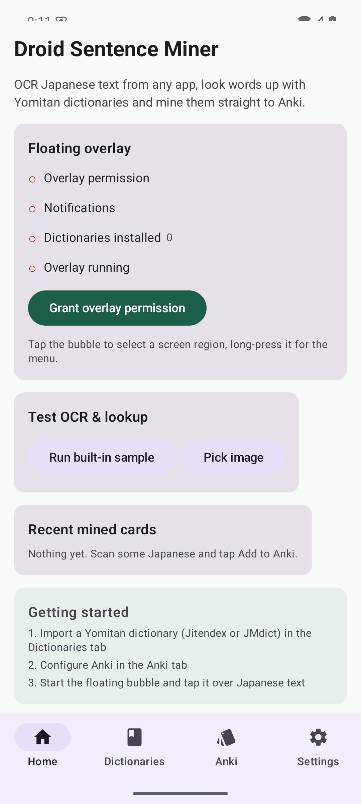
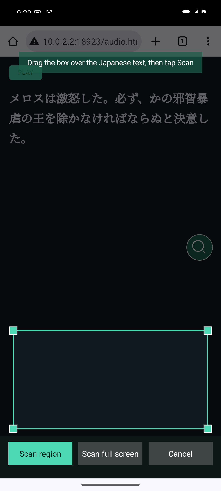
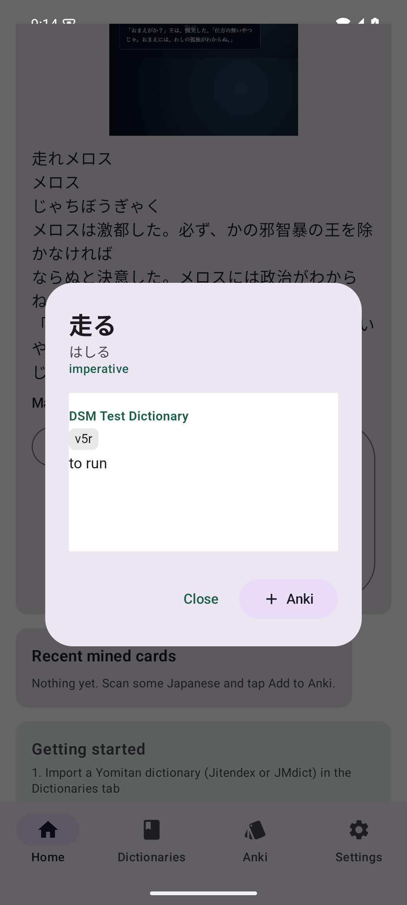
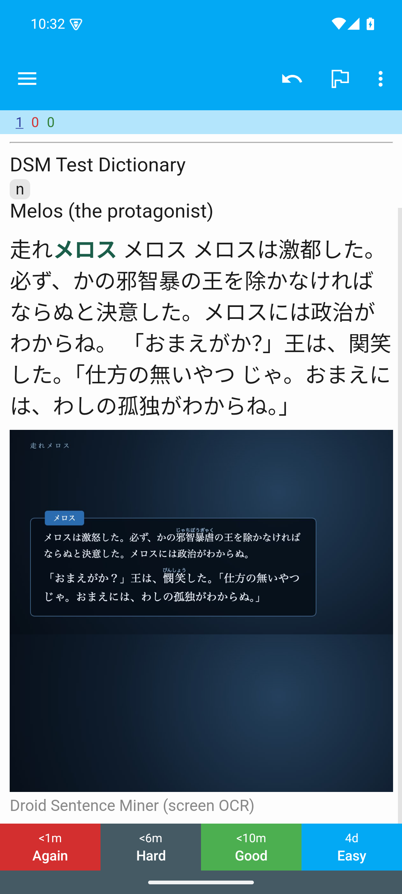

# Droid Sentence Miner

A native Android sentence miner for Japanese immersion: OCR text from any app with a floating
popup, look words up with Yomitan dictionaries, and mine them into Anki — plus the game's voice
line as sentence audio.

Inspired by [GameSentenceMiner](https://github.com/bpwhelan/GameSentenceMiner), rebuilt for Android
with [Yomitan](https://github.com/yomidevs/yomitan) dictionary compatibility.

<p align="center">
  
  
  
  
</p>

## Features

- **Auto OCR mode** — set the capture region once (e.g. the dialogue box) and keep playing. The
  region is read every ~400 ms; each new line is logged with the moment it appeared, the moment it
  went away and a screenshot. Repeated reads must agree before a line counts, so fades, typewriter
  text and noise over moving video don't create junk, and background signage is filtered out.
- **Texts page** (GSM's texthooker) — every recognized line, newest first. Tap a line, tap a word,
  and mine it: the card gets that line's sentence, its screenshot and its voice clip.
- **Replay buffer sentence audio** — the last 5 minutes (configurable 1–10) of game audio are kept
  in memory. Any line still inside the buffer can be mined with audio cut from when it appeared to
  when it was replaced (± configurable offsets). Preview or fine-tune it in the waveform editor
  before mining; optional (experimental) silence trimming is in Settings.
- **Floating popup overlay** — a draggable bubble that lets you select any screen region, OCR it,
  and look up words without leaving the game. Long-press opens a menu; the notification stays
  available as a shortcut.
- **Japanese OCR** — on-device ML Kit text recognition with a GameSentenceMiner-style two-pass
  pipeline: detect, merge lines, filter furigana/UI noise, then re-read each line at higher
  resolution and keep the better result.
- **Yomitan dictionaries** — import any Yomitan/Yomichan format 3 `.zip` (Jitendex, JMdict,
  KANJIDIC, frequency dictionaries) or install Jitendex/JMdict/KANJIDIC with one tap.
  Term, kanji, tag, term-meta and kanji-meta banks are all parsed, including structured-content
  glossaries and dictionary images.
- **Deinflection & word scanning** — a full Japanese deconjugator drives longest-match scanning of
  scanned text and tap-to-look-up, with the same rules Yomitan uses.
- **Anki mining** — two backends:
  - **AnkiDroid API** (no network needed; cards, images and audio via the official API), and
  - **AnkiConnect** (desktop Anki with the AnkiConnect add-on; card + media upload over HTTP).
  Cards include Expression, Reading, Meaning (rendered glossary), Sentence (target word bolded),
  Image (captured screenshot), Audio (sentence voice line) and Source.
- **Sentence audio** (Android 10+) — captures playback audio through the existing MediaProjection
  session (the Android equivalent of GSM's loopback capture) into the replay buffer, with a
  waveform **audio editor** to trim the exact line before mining.
- **Mining history** — recent cards with a status showing whether they made it into Anki.
- **Text selection lookup** — other apps can share selected text via `ACTION_PROCESS_TEXT`.

## Requirements

- Android 8.0 (API 26) or newer. Audio capture requires Android 10+; screen sharing follows the
  Android 14/15 consent flow (app picker + foreground service type).
- [AnkiDroid](https://github.com/ankidroid/Anki-Android) (2.16+) and/or desktop Anki with
  [AnkiConnect](https://foosoft.net/projects/anki-connect/).

## Building from the command line

No Android Studio required.

```bash
# 1. Toolchain — JDK 21 + Android CLI (Linux example, no root needed)
curl -fsSL https://dl.google.com/android/cli/latest/linux_x86_64/install.sh | bash
mkdir -p ~/Android/tools && curl -sSL "https://api.adoptium.net/v3/binary/latest/21/ga/linux/x64/jdk/hotspot/normal/eclipse" | tar xz -C ~/Android/tools
export JAVA_HOME=$(echo ~/Android/tools/jdk-21*)      # macOS: brew install openjdk@21
export ANDROID_HOME=$HOME/Android/Sdk
export PATH="$JAVA_HOME/bin:$ANDROID_HOME/platform-tools:$PATH"

# 2. Android SDK packages
android sdk install platform-tools platforms/android-36 build-tools/35.0.0 emulator \
                    system-images/android-35/google_apis_playstore/x86_64
echo "sdk.dir=$ANDROID_HOME" > local.properties

# 3. Build & test
./gradlew testDebugUnitTest          # 87 JVM unit tests
./gradlew connectedDebugAndroidTest  # 4 on-device tests (VAD + AAC encoding)
./gradlew assembleDebug              # app/build/outputs/apk/debug/app-debug.apk

# 4. Install
adb install -r app/build/outputs/apk/debug/app-debug.apk
```

## Usage

1. **Dictionaries** — open the *Dictionaries* tab and install **Jitendex** with one tap (or import
   any Yomitan `.zip`).
2. **Anki** — in the *Anki* tab pick a backend:
   - *AnkiDroid*: install AnkiDroid, grant the API permission from the tab, and enable
     *Settings → Advanced → AnkiDroid API* inside AnkiDroid.
   - *AnkiConnect*: start Anki with the AnkiConnect add-on and enter the URL
     (e.g. `http://192.168.1.10:8765`).
   Pick a deck and note type (a "Droid Sentence Miner" note type is created automatically).
3. **Auto OCR (recommended)** — tap *Start floating bubble*, tap the bubble and drag the capture
   box over the game's dialogue area, then long-press the bubble → *Start auto OCR* (or use the
   switch on the *Texts* tab / the notification). Keep playing; open *Texts* whenever you want to
   mine a line — tap the line, tap the word, *Anki*. Long-press → *Mine the latest line* does the
   same without leaving the game.
4. **Manual scan** — tap the bubble, adjust the capture box and hit *Scan region*. Tap a
   highlighted word for definitions, then *Anki*. Manual scans are logged on *Texts* too.
5. **Audio** — on by default; grant the microphone permission when asked (Android requires it for
   playback capture). *Settings* has the buffer length, start/end offsets and silence trimming.
   Apps that opt out of capture stay silent.
6. **Test drive** — the Home tab has a built-in sample (a public-domain Aozora Bunko passage) and
   an image picker to test OCR + lookup without a game.

## How it works

```
MediaProjection ──► ScreenCaptureManager ──► AutoOcrController ──► TextLineTracker ──► TextLog (Room)
                        │   (new frames only)    (fast OCR → stable?     (start/end times,    │
                        │                         → two-pass re-read)      screenshot)       │
                        │                                                                    ▼
                        └──► AudioCaptureManager ──► AudioRingBuffer ──► ClipWindow + VoiceTrimmer
                                (AudioPlaybackCapture)   (last N min)         (line's voice clip)
                                                                                    │
                                                                                    ▼
   OCR text ──► TermLookup.scan() ──► JapaneseDeinflector ──► Room DB (Yomitan dictionaries)
                        │                                        │
                        ▼                                        ▼
                 Overlay popup (Compose + WebView)        Glossary parser/Renderer
                        │
                        ▼
                 CardMiner ──► AnkiDroid API or AnkiConnect
```

- **OCR**: ML Kit bundled Japanese model. Pass 1 recognizes the capture region; lines are merged,
  furigana-sized kana lines and non-Japanese UI lines are dropped, text is NFKC-normalized; pass 2
  crops each line, upscales it and re-runs recognition, keeping the better Japanese reading.
- **Matching**: `JapaneseDeinflector` expands every substring of the OCR text into dictionary-form
  candidates (Yomitan/Jiten rules), a single batched SQL query resolves them, and longest-match-wins
  builds the clickable word list. Grammar-only single-kana matches are filtered as noise.
- **Storage**: Room DB with `terms`, `kanji`, `tags`, `term_meta`, `kanji_meta`, `dictionaries` and
  `mined_cards` tables; indices on expression/reading for fast lookup.
- **Overlay**: a foreground service draws the bubble, capture selector and a Compose result panel;
  MediaProjection consent is handled by a transparent activity that forwards the result to the
  service (with the Android 14/15 foreground-service-type ordering).

## Dictionary compatibility

Yomitan/Yomichan format 3 (and legacy format 2) zips are supported:

| Bank | Usage |
| --- | --- |
| `index.json` | title, revision, languages, frequency mode |
| `term_bank_N.json` | `[expression, reading, definitionTags, rules, score, glossary, sequence, termTags]` |
| `kanji_bank_N.json` | `[character, onyomi, kunyomi, tags, meanings, stats]` |
| `tag_bank_N.json` | tag metadata shown as chips |
| `term_meta_bank_N.json` / `kanji_meta_bank_N.json` | frequency and pitch metadata |
| `styles.css` + images | applied in the popup WebView; images embedded in Anki via media files |

Glossaries may be strings, arrays, image definitions, deinflection entries or structured content
(div/span/ul/table/ruby...), all parsed and rendered.

## Compatibility notes

- **AnkiConnect** is plain HTTP; the app ships a network security config that permits cleartext so
  LAN/emulator URLs work. Only user-configured AnkiConnect traffic is affected.
- **AnkiDroid API**: current AnkiDroid releases take `addNote(modelId, deckId, ...)`. If a note type
  was just created through the API and the backend refuses it, the app retries with the built-in
  *Basic* note type so your card is still created. Tested against AnkiDroid 2.24.1 (works,
  including media); AnkiDroid 2.25.0 has a provider bug with freshly-created note types.
- **Emulator**: with a headless emulator, starting MediaProjection can black out the emulated
  display (SwiftShader/host GPU limitation). OCR, lookup, audio encode and Anki paths are all
  testable; for end-to-end screen capture use a device or a windowed emulator.

## Validation

- Auto OCR end-to-end on a Galaxy S24+ (Android 16) against a YouTube video with Japanese soft
  subtitles, compared with the subtitle file and the original audio (see AGENTS.md for the
  recipe): every subtitle cue in the run was logged (61/61, 56 exact, mean character accuracy
  0.99), line start times within ±300 ms (p90) of the cue, and every voice clip located in the
  original audio at correlation ≥0.97, starting 160–1080 ms (median ~400 ms) before the subtitle.
- 87 JVM unit tests: replay buffer, voice trimming, line tracking, clip windows, subtitle-row
  filtering, deinflector (conjugations across godan/ichidan/suru/kuru/adjectives),
  glossary parsing/rendering, OCR post-processing (merge, furigana filter, normalization),
  VAD segmentation, PCM utilities, Yomitan index parsing.
- 4 on-device instrumented tests: VAD segmentation with real waveforms, AAC/M4A encoding through
  MediaCodec, WAV fallback.
- Emulator end-to-end: Jitendex one-click install (436,555 terms), OCR of an Aozora Bunko passage
  (20 matched words, deinflection of 走れ → 走る), popup lookup, mining into a real AnkiDroid
  installation (card verified with image), and mining through AnkiConnect against a mock server
  (note + media verified), plus MediaProjection consent flow.

## Roadmap

- Neural VAD (Silero via ONNX Runtime, as GSM uses) for silence trimming that holds up under
  loud BGM; the current energy trimmer is opt-in for that reason.
- Optional ASR engines (e.g. whisper.cpp or Moonshine via JNI) as an alternative/complement to OCR
  for games with hard-to-read fonts.
- Manga-style OCR models (manga-ocr) behind the existing `OcrEngine` abstraction.
- Per-dictionary frequency display modes and pitch-accent graphs.
- Quick Settings tile and share-sheet mining.

## Credits

This project stands on the shoulders of these projects — thank you:

- **[GameSentenceMiner](https://github.com/bpwhelan/GameSentenceMiner)** (GPL-3.0) — the whole
  concept: OCR on untranslated games, popup lookups, one-press Anki cards with audio, the two-pass
  OCR pipeline and the sentence-audio editing workflow.
- **[Yomitan](https://github.com/yomidevs/yomitan)** (GPL-3.0) — the dictionary format, deinflection
  approach, structured-content glossaries and popup UX that this app implements for Android.
- **[Yomihon](https://github.com/yomihon/yomihon)** (Apache-2.0) — the Kotlin Japanese deinflector in
  `JapaneseDeinflector.kt` is adapted from this project (which in turn credits Jiten). Also a great
  reference for Android Yomitan-dictionary parsing.
- **[Jiten](https://github.com/Sirush/Jiten)** — deinflection rule data used by the deinflector.
- **[ML Kit](https://developers.google.com/ml-kit)** (Google) — on-device Japanese text recognition.
- **[AnkiDroid](https://github.com/ankidroid/Anki-Android)** (GPL-3.0) — the AnkiDroid API used for
  card creation.
- **[AnkiConnect](https://foosoft.net/projects/anki-connect/)** — the HTTP API used for desktop Anki.
- **[OwOCR](https://github.com/AuroraWright/owocr)** and **[MeikiOCR](https://github.com/rtr46/meikiocr)**
  — two-pass OCR concepts used by GSM.
- **[Aozora Bunko](https://www.aozora.gr.jp/)** — the bundled sample image uses a passage from
  走れメロス by 太宰治 (public domain), with ruby markup, which doubles as a furigana-filter test case.
- **[Jitendex](https://jitendex.org/)** and **[jmDict for Yomitan](https://github.com/yomidevs/jmdict-yomitan)**
  — the one-click recommended dictionaries (installed from their official releases).

Droid Sentence Miner is not affiliated with Anki, AnkiDroid, Yomitan, Jiten or GameSentenceMiner.

## License

[GPL-3.0](LICENSE). The adapted Yomihon deinflector remains available under its Apache-2.0 license
wherever required; see the file header for details.
