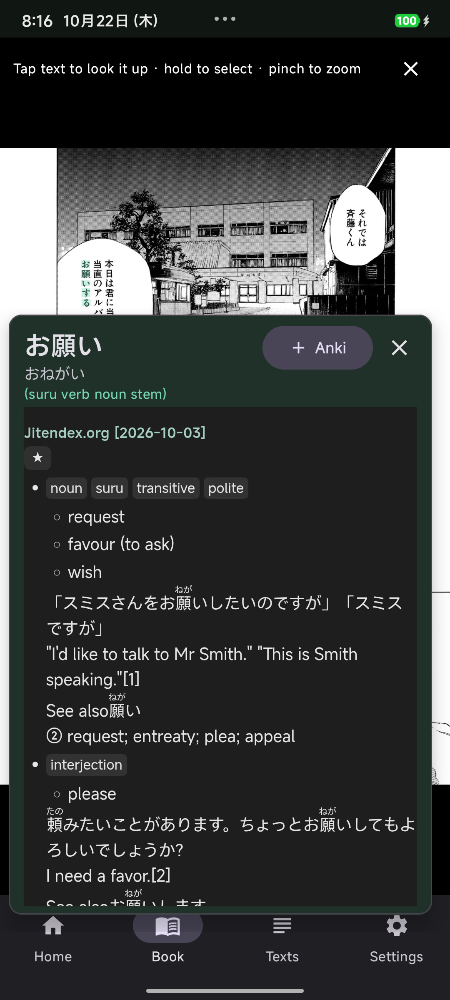
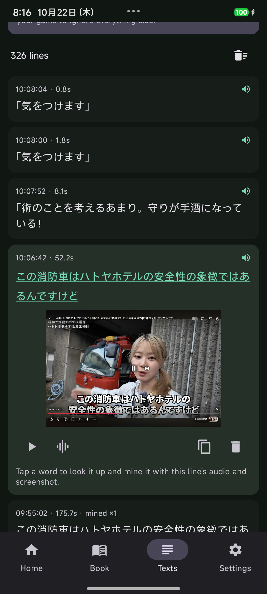
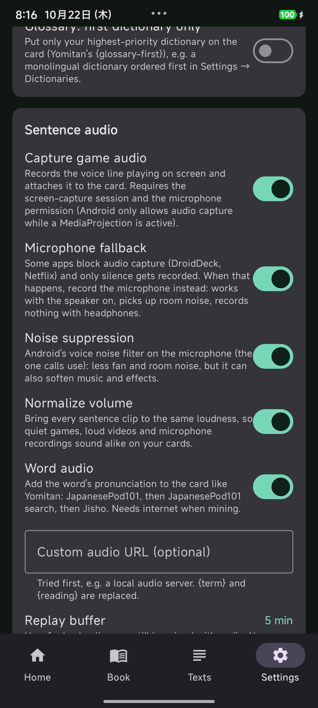
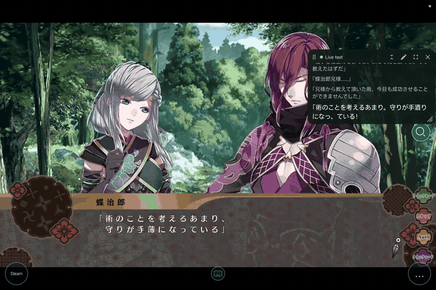
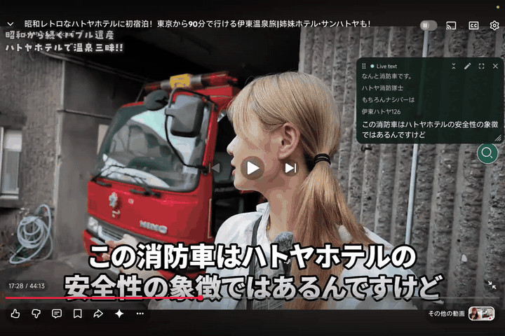
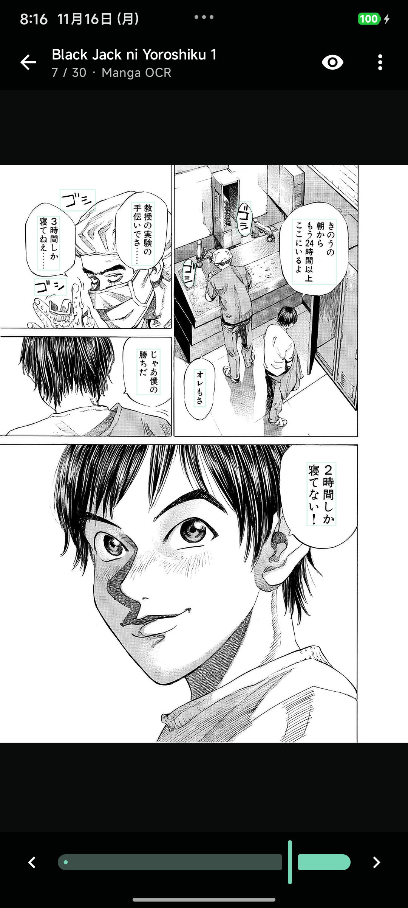
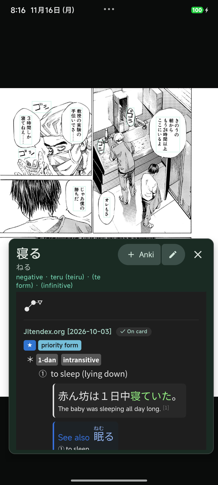
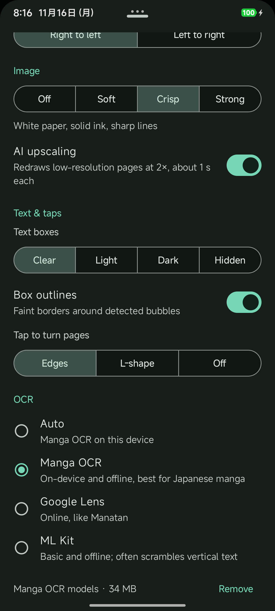
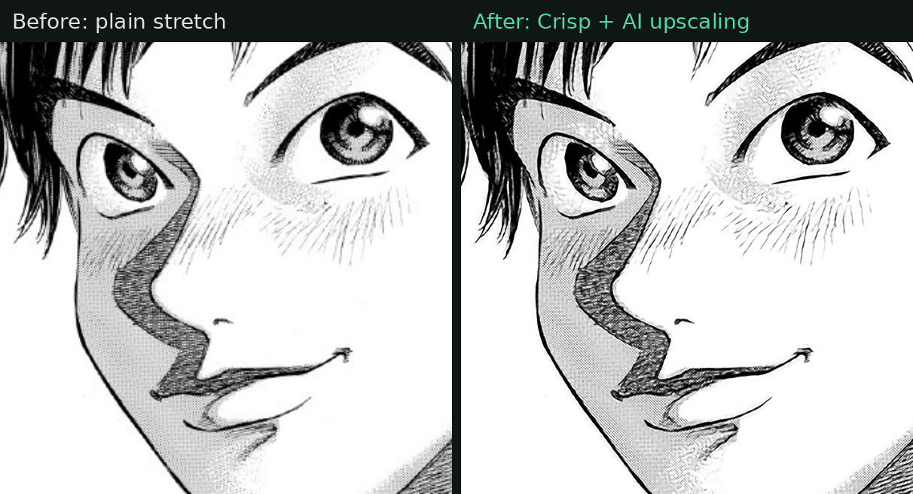

# Droid Sentence Miner

A native Android sentence miner for Japanese immersion: OCR text from any app with a floating
popup, look words up with Yomitan dictionaries, and mine them into Anki — plus the game's voice
line as sentence audio. Japanese is the focus; English, German and French are supported too, and other languages can
be added as modules that download nothing unless you study them.

Inspired by [GameSentenceMiner](https://github.com/bpwhelan/GameSentenceMiner), rebuilt for Android
with [Yomitan](https://github.com/yomidevs/yomitan) dictionary compatibility.

**Website:** [wilsonnet.github.io/droid-sentence-miner](https://wilsonnet.github.io/droid-sentence-miner/) ·
**User docs:** [Installation](https://wilsonnet.github.io/droid-sentence-miner/docs/getting-started/installation/) ·
[Auto OCR](https://wilsonnet.github.io/droid-sentence-miner/docs/guides/auto-ocr/) ·
[Troubleshooting](https://wilsonnet.github.io/droid-sentence-miner/docs/reference/troubleshooting/) ·
**[Changelog](CHANGELOG.md)**

<p align="center">
  
  
  
</p>

## Demo

| Visual novel (Nightshade on Steam via DroidDeck) | YouTube hardsubs |
| --- | --- |
| [](docs/videos/nightshade-mining.mp4) | [](docs/videos/youtube-mining.mp4) |
| Tap 手薄 in the game's text box → definition → *Anki* → ✓ *In Anki* | Tap 消防車 in the burned-in subtitle → *Anki* → ✓ *In Anki* |

Both cards got the sentence, a screenshot, word audio and the sentence's voice clip (click a
GIF for the MP4; recorded on a Xiaomi Pad 7).

## Manga reader

Open `.cbz` volumes, tap any word in a speech bubble, and send it to Anki with the panel as the
picture. Raw volumes are read by on-device manga OCR (no account, no upload); `.mokuro` files load
instantly. Blurry, low-resolution scans are cleaned up as you read: whiter paper, solid ink,
sharp lines, and AI upscaling for small pages.

<p align="center">
  
  
  
</p>

<p align="center">
  
</p>

An 849×1200 scan at phone size: the reader's old plain stretch (left) and the default *Crisp* filter
with AI upscaling (right). Pages: *Black Jack ni Yoroshiku* by Shuho Sato (free for secondary use).

## What it does

- **Auto OCR** — box the game's dialogue or a video's subtitles once; every new line is logged
  with its screenshot and voice clip, using OCR trained on game fonts
  ([meikiocr](https://github.com/rtr46/meikiocr), ML Kit as fallback).
- **Tap the real text** — an invisible layer over the on-screen text lets you tap a word in any
  app and get its definition right there. A floating bubble, a live text window and a *Texts* log
  do the same.
- **Yomitan dictionaries** — Jitendex, JMdict, monolingual dictionaries, pitch and frequency
  dictionaries, with images and dictionary CSS. Install them with one tap, from files or from
  Google Drive; reorder by dragging.
- **Anki cards like Yomitan/GSM make them** — through AnkiDroid or AnkiConnect: sentence,
  screenshot, sentence audio, word audio, pitch graph, mapped to your existing note type.
- **Sentence audio** — a replay buffer of the app's audio, a waveform editor, loudness
  normalization, and a calibrated microphone fallback for apps that block capture.
- **Books and manga (`.cbz`)** — read `.cbz` manga from local files or Google Drive with
  `.mokuro` overlays, on-device manga OCR (PP-OCRv6_manga + a bubble detector) or Google Lens (plus
  background volume pre-OCR, single/double-page/vertical modes, readable text boxes, a page filter
  with Anime4K AI upscaling for blurry scans, and panel cropping before sending to Anki), or
  photograph a printed page and tap the text to look it up.
- **AI explanations (optional)** — a grammar breakdown of the sentence focused on the tapped word:
  one tap opens Gemini with the prompt typed, or bring your own API key (Gemini free tier, Groq,
  OpenRouter, OpenAI, Anthropic, Ollama…) for answers in the popup and on the card. Editable
  prompts; one switch hides it all.
- **Multilingual, Japanese first** — pick the language you study on first launch: Japanese
  (main focus), English, German or French (Wiktionary dictionaries, inflections, IPA, noun genders on
  cards, optional PaddleOCR pack); each language has its own Anki deck, note type and card
  contents ([dictionaries per language](docs/dictionaries.md)).
  Only that language's dictionaries and models are downloaded. New languages are small modules
  ([how](.opencode/skills/dsm-language/SKILL.md)).

Every feature in detail: [docs/features.md](docs/features.md).

## Get it

Android 8.0+ (sentence audio needs Android 10+), plus [AnkiDroid](https://github.com/ankidroid/Anki-Android)
or desktop Anki with [AnkiConnect](https://foosoft.net/projects/anki-connect/). Signed APKs are on
[GitHub Releases](https://github.com/WilsonNet/droid-sentence-miner/releases); newer releases
upgrade in place.

**Quick start:** *Settings → Dictionaries* → install Jitendex · *Settings → OCR* → download
meikiocr · *Settings → Anki* → pick a backend, deck and note type · start the bubble, open your
game, long-press the bubble → *Start auto OCR*. The full walkthrough is in the
[installation guide](https://wilsonnet.github.io/droid-sentence-miner/docs/getting-started/installation/)
and [docs/usage.md](docs/usage.md).

## Documentation

| For | Read |
| --- | --- |
| Users | [Website docs](https://wilsonnet.github.io/droid-sentence-miner/docs/) (guides, settings, troubleshooting) · [docs/usage.md](docs/usage.md) |
| What changed | [CHANGELOG.md](CHANGELOG.md) |
| How it works | [docs/architecture.md](docs/architecture.md) — pipeline, dictionary format support, compatibility notes |
| Measurements | [docs/validation.md](docs/validation.md) — OCR accuracy, latency, audio and lookup benchmarks |
| What's next | [docs/roadmap.md](docs/roadmap.md) |
| Contributors | [docs/building.md](docs/building.md) · [AGENTS.md](AGENTS.md) (toolchain, debug API, design notes and pitfalls) · [`.opencode/skills/`](.opencode/skills/) (device testing recipes) |

## Contributing

Everything builds from the command line — no Android Studio needed:

```bash
./gradlew testDebugUnitTest assembleDebug   # JDK 21 + Android SDK, see docs/building.md
adb install -r app/build/outputs/apk/debug/app-debug.apk
```

`./gradlew detekt detektDebug lintDebug testDebugUnitTest` is the PR gate: every detekt/ktlint
rule, every Android Lint check, and architecture tests that keep language modules separate
([details](docs/building.md#linting-and-module-rules)). Debug builds include a localhost HTTP API for driving and checking the app over adb, so most
changes can be validated with `curl` on a real device. Before opening a PR, read
[AGENTS.md](AGENTS.md): it lists the pitfalls already paid for, and every change updates the docs
in the same commit ([checklist](.opencode/skills/dsm-docs/SKILL.md)). The website lives in
[`site/`](site/) (Astro + Starlight).

## Credits

This project stands on the shoulders of these projects — thank you:

- **[Manatan](https://github.com/KolbyML/Manatan)**, **[Mokuro](https://github.com/kha-white/mokuro)**,
  and **[Mokuro Reader](https://github.com/ZXY101/mokuro-reader)** — the manga reading UX, `.mokuro`
  JSON schema, Google Lens + `merge.rs` speech-bubble filtering/clustering pipeline, overlay style
  options, and reading mode layout that inspired our `.cbz` reader.
- **[PP-OCRv6_manga](https://huggingface.co/Kellenok/PP-OCRv6_manga)** by Kellenok (Apache-2.0,
  PaddleOCR fine-tuned on Manga109-s) and **[comic-text-and-bubble-detector](https://huggingface.co/ogkalu/comic-text-and-bubble-detector)**
  by ogkalu (Apache-2.0) — the on-device manga OCR models, downloaded from Hugging Face at runtime.
- **[Anime4K](https://github.com/bloc97/Anime4K)** by bloc97 (MIT) — the Restore and x2 upscaling
  CNNs behind the manga reader's *AI upscaling*, converted from its mpv shaders into a small ONNX
  graph bundled in the APK (`tools/manga-eval/anime4k_onnx.py`). AMD's
  [FidelityFX CAS](https://gpuopen.com/fidelityfx-cas/) (MIT) is the page filter's sharpener.
- **[Black Jack ni Yoroshiku](https://densho810.com/free/)** by Shuho Sato — free for secondary use;
  its pages appear in the README and website screenshots.
- **[GameSentenceMiner](https://github.com/bpwhelan/GameSentenceMiner)** (GPL-3.0) — the whole
  concept: OCR on untranslated games, popup lookups, one-press Anki cards with audio, the two-pass
  OCR pipeline and the sentence-audio editing workflow.
- **[Yomitan](https://github.com/yomidevs/yomitan)** (GPL-3.0) — the dictionary format, deinflection
  approach, structured-content glossaries and popup UX that this app implements for Android.
- **[Yomihon](https://github.com/yomihon/yomihon)** (Apache-2.0) — the Kotlin Japanese deinflector in
  `JapaneseDeinflector.kt` is adapted from this project (which in turn credits Jiten). Also a great
  reference for Android Yomitan-dictionary parsing.
- **[Jiten](https://github.com/Sirush/Jiten)** — deinflection rule data used by the deinflector.
- **[meikiocr](https://github.com/rtr46/meikiocr)** by rtr46 (code Apache-2.0, models
  [meiki.text.detect.v0](https://huggingface.co/rtr46/meiki.text.detect.v0) and
  [meiki.txt.recognition.v0](https://huggingface.co/rtr46/meiki.txt.recognition.v0), LGPL-3.0) —
  the default OCR engine; the models are downloaded from Hugging Face at runtime and the
  pre/post-processing in `MeikiDecoder.kt` is ported from its reference pipeline. The APK ships
  modified graphs of both models (shorter detector inputs, any-width recognizer; LGPL-3.0, built
  by `tools/meiki-variants` from the originals, whose weights they read at runtime).
- **[meikidroid](https://github.com/rtr46/meikidroid)** by rtr46 — Android game OCR overlay that
  served as a reference for the region-capture + overlay workflow and the hotkey idea.
- **[ONNX Runtime](https://onnxruntime.ai/)** (MIT) — runs meikiocr and PaddleOCR on device.
- **[PaddleOCR](https://github.com/PaddlePaddle/PaddleOCR)** (Apache-2.0) — PP-OCRv5 detector and
  PP-OCRv6 recognizer ONNX models from [huggingface.co/PaddlePaddle](https://huggingface.co/PaddlePaddle),
  repackaged unmodified in the optional English OCR pack (GitHub Releases `lang-en-*`).
- **[Wiktionary](https://www.wiktionary.org/)** via **[kaikki.org](https://kaikki.org/)** and
  **[wty / wiktionary-to-yomitan](https://github.com/yomidevs/wiktionary-to-yomitan)** (CC BY-SA) —
  the one-click English dictionaries and IPA; English word audio comes from Wiktionary's recordings
  on [Wikimedia Commons](https://commons.wikimedia.org/) (the same source Yomitan uses).
- **[ML Kit](https://developers.google.com/ml-kit)** (Google) — on-device Japanese text recognition (alternative engine).
- **[AnkiDroid](https://github.com/ankidroid/Anki-Android)** (GPL-3.0) — the AnkiDroid API used for
  card creation.
- **[AnkiConnect](https://foosoft.net/projects/anki-connect/)** — the HTTP API used for desktop Anki.
- **[OwOCR](https://github.com/AuroraWright/owocr)** — two-pass OCR concepts used by GSM.
- **[Aozora Bunko](https://www.aozora.gr.jp/)** — the bundled sample image uses a passage from
  走れメロス by 太宰治 (public domain), with ruby markup, which doubles as a furigana-filter test case.
- **[Kanjium](https://github.com/mifunetoshiro/kanjium)** (CC BY-SA 4.0) — the one-click pitch accent
  data. "The pitch accent notation, verb particle data, phonetics, homonyms and other additions or
  modifications to EDICT, KANJIDIC or KRADFILE were provided by Uros O. through his free database."
- **[Jitendex](https://jitendex.org/)** and **[jmDict for Yomitan](https://github.com/yomidevs/jmdict-yomitan)**
  — the one-click recommended dictionaries (installed from their official releases).

Droid Sentence Miner is not affiliated with Anki, AnkiDroid, Yomitan, Jiten or GameSentenceMiner.

## License

[GPL-3.0](LICENSE). The adapted Yomihon deinflector remains available under its Apache-2.0 license
wherever required; see the file header for details.
